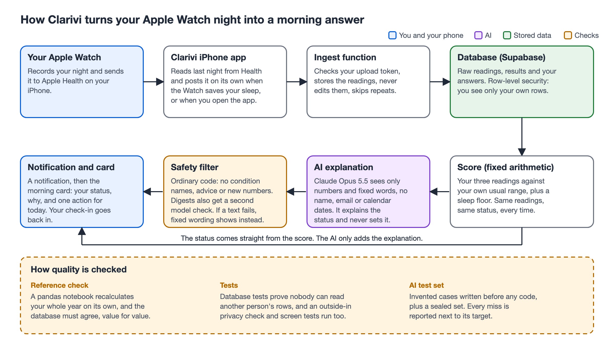

# Clarivi

**An iPhone app that turns my own Apple Watch data into a plain-words morning answer: what last night means against my normal, why, and one thing to do today.**

> [!IMPORTANT]
> **Project in progress.** Two test weeks are done, both with an iPhone Shortcut doing the sync. Week one (19 to 25 October 2026) missed the sync target (4 of 7 days against 6); week two (2 to 8 November) met it (6 of 7). Both times the calculations matched an independent check on my whole year, with 0 values different. Since 10 November 2026 the sync is a native iPhone app that reads Health on its own; its mornings are not counted yet.

## The problem

Apple Watch and the Health app collect an unusually rich stream of physiological and behavioural data (heart rate, heart rate variability, sleep and workouts), but mostly show each metric as an isolated daily card, with little sense of trend. There is no way to see how a metric is drifting over time, how it relates to other metrics, or whether today's reading is actually unusual for this person. This project builds a tool that takes a person's own Apple Watch data each morning and turns it into a personal picture over time of their own recovery, sleep and training patterns.

- **Who it is for:** Apple Watch users who train consistently (strength training, general fitness) and already track workouts and sleep, but want to understand the patterns behind their numbers rather than just seeing isolated daily readings.
- **What problem it solves:** Apple Health has no way to detect drift against a person's own baseline, surface relationships between metrics (for example sleep and next-day recovery), or tell a normal day from an unusual one.
- **Why it matters:** without that visibility, early signs of under-recovery, overtraining or illness go unnoticed until performance or health has already suffered, and users cannot tell whether a change they made (more sleep, a deload week) actually worked.
- **What the user should be able to do:** wake up and get a plain-words answer from their own data: whether last night, set against their own normal, is meaningfully off, why, and one action for the day, with the past weeks of each reading one tap away.
- **The outcome:** earlier, evidence-based awareness of their own recovery and readiness, so training and lifestyle adjustments are driven by their own data rather than generic guidance.

Version 1 builds the first part of this: the morning answer against the person's own normal. The relationships between readings were tested on my own year and not built (see Small on purpose below).

Clarivi gives the answer first, in plain words, and keeps the working one tap away. It never names a medical condition and never gives medical advice.

## Clarivi video demo, 1 minute 37 seconds

https://github.com/user-attachments/assets/b49f8721-7d24-4163-85a5-753b05a20791

## At a glance

- **The user and the problem:** The Apple Watch provides a lot of data points with no guidance as to how to interpret them. Using only their own Apple Watch data, a user learns each morning whether their recovery has drifted from their personal baseline, and gets one data-backed action for the day.
- **What it does:** each morning a card says Ready, Ease off or Rest, in a few plain sentences, with one action for the day. A "Why today" screen shows exactly how the status was decided.
- **How it works:** the iPhone app reads the overnight readings from Health and posts them on its own. Fixed arithmetic in SQL scores them against my own usual range. The AI (Claude Opus 5.5) writes the wording. It never sets the status.
- **How quality was defined:** ten measures with targets, set on 29 September 2026, before any result existed.
- **Results, two test weeks (October and November 2026):** the calculations match an independent check on my whole year (0 values differ, both weeks), and isolation held both weeks. The sync target was missed in week one (4 of 7 days had a post, against 6) and met in week two (the status shown before noon on 6 of 7). The score's Signal and quiet-by-default targets missed on my year both times.
- **Status:** built and in use by one person. Both test weeks are done. After week two the Shortcut was replaced by the iPhone app (D115, D118), which I install on my own iPhone from Xcode.
- **How it was built:** I wrote the problem, the specs and every decision in the log, and Claude Code wrote the code, tests and queries to them. I reviewed every screen and every word, ran every manual check on my own iPhone, and decided what to cut.
- **Direct links:** [case study](https://claude.ai/artifact/KMTsEC7RWHn3aHfmUtYFaC) · [Project Memory](https://claude.ai/artifact/5Aw5x3PYAro7pDXQRkapTe) · [live demo on made-up data](https://apple-health-rust.vercel.app)



## How it works

One morning, from my side:

1. **Data arrives by itself.** The Clarivi iPhone app reads my Watch's sleep and heart readings from Health and posts them, when the Watch saves my sleep or when I open the app, between 4am and 8pm. There is no manual export. During the two test weeks an iPhone Shortcut did this instead, run by my alarm, my charger and a chosen app.
2. **The server scores the night.** It compares three readings with my own usual range over the last 42 nights: overnight heart rate variability, sleep, and sleeping heart rate. Each reading that is worse than usual earns points, with fixed weights. The points set Ready, Ease off or Rest. A night with sleep far below my usual cannot be Ready (the sleep floor).
3. **The AI writes the explanation.** It is sent only my results, never my name, email address or calendar dates, and it is told the status as a fact. A word filter checks the text, and for the weekly digest a second AI call checks every claim against the data. If anything fails, fixed wording appears instead.
4. **I see the card.** A notification opens it. I answer "How do you feel today?" before the status shows, so the answer cannot be swayed by it and can be compared with it later. On days with a change, an 8pm question asks whether I followed the nudge.
5. **If the status is missing,** an 11:30 reminder tells me to tap Sync now before noon. If last night only arrives after noon, the card still shows the status, marked late, with no nudge and no 8pm question.

The full picture is in the [architecture diagram](docs/architecture.pdf) and the [tech spec](docs/tech-spec.md).

## Planned and tested like a product

- **Project Memory:** the [product spec](docs/product-spec.md), [design](docs/design.md), [tech spec](docs/tech-spec.md), [phased plan](docs/progress.md) and [MVP decisions](docs/mvp.md), each agreed before building. Also published as a [website](https://claude.ai/artifact/5Aw5x3PYAro7pDXQRkapTe) with live plan ticks.
- **Automated tests:** unit and screen tests (Vitest, Playwright), database tests (pgTAP), server function tests (Deno), and the pandas reference check. Run `python3 checks/run_all.py` for the publishing checks.
- **Case study:** [read it as a web page](https://claude.ai/artifact/KMTsEC7RWHn3aHfmUtYFaC). Both test weeks' results.

## Key design choices and tradeoffs

- **Plain words before charts.** The card's briefing uses no numbers; they sit behind "Why today" and "Show the numbers". The cost: less detail on the first screen, and more work on wording.
- **A fixed score, not a learned model.** Weights and thresholds are set in advance, written in SQL, and checked against separate pandas code. I can explain every status. The cost: it cannot adapt to me. A Ready on a very short night showed that, which led to the sleep floor, which in turn made the score less quiet (see the results).
- **The AI explains and never decides.** Its input is an allow-list of results, tested with a marker in every forbidden field. Its output goes through a filter, a retry and a fixed fallback. The cost: a short "Getting ready" wait, about a cent per answer, and a third consent box because Anthropic processes the results. I chose one model and did not compare models.
- **From a Shortcut to an iPhone app.** Both test weeks synced through an iPhone Shortcut: no app to build or maintain. Week two met the sync target, but only by leaning on four different triggers and the 11:30 reminder, and my own account was that it still needed me to sync by hand or stop an alarm, which I don't set on most days. So the same web app now runs inside a small native iPhone app that reads Health itself (D115). The cost: Swift of my own to maintain, and because it is installed with a free Apple ID rather than a paid developer account, I have to reinstall it from my Mac every 7 days. The Watch still decides when a night reaches Health, and Clarivi cannot see that moment.
- **Private by default.** Every table has row-level security, there are no third-party scripts or tracking, and secrets live only in Supabase's secret store. The cost: more setup, and a consent screen before anything else.
- **Small on purpose.** I cut the test from four people to one before any result existed (D89, D91). I tested three planned analysis modules on my own year before building them: two found nothing the data could support (0 of 12 each) and the third missed its target (a one-spread shift found 10% of the time, against 80%), so I built none. The cost: a thinner product, and a result that cannot speak for anyone else.

## How quality was defined and measured

**What good looks like (set 29 September 2026, before any result).**

| Measure | Target |
|---|---|
| Sync | A successful morning sync on at least 6 of 7 days |
| Notifications | Delivered on at least 90% of synced days that have a status |
| Isolation | One person's data never reaches another: no tolerance |
| Correctness | Matches an independent pandas reference; no unfinished night is ever scored |
| Signal, on my year | At least 2 in 3 disrupted days called Ease off or Rest |
| Quiet by default | Ease off and Rest together on no more than about 1 day in 7 |
| Check-ins against status | Agree more often than chance |
| Engagement | Card opened or notification tapped on at least 5 of 7 days |
| Action | Nudge followed about half the time on change days |
| My own account | A short written account at the end |

Before any result, the test shrank from four people over 28 days to one person over one week, so the sync and engagement targets were re-scaled (D89, D91). After week one's results, no target changed. One counting rule did: from week two, a "successful sync" means the status was worked out and shown before noon (D99, decided before any week-two result). Week one stays as recorded.

**How it was measured.** The counting rules were written into a query file before its numbers were computed, and week two reruns the same file. The pandas reference recalculates every night, usual range and status and compares each with the database. The AI was tested on invented cases only: 40 for development, and 20 held-out cases written and graded by two separate Claude sessions that had not seen the app. The same Claude Code session that built the app also counted both weeks, so the separation is by written rules, not by a second person.

**Results, both test weeks.** Week one ran 19 to 25 October 2026, week two 2 to 8 November 2026, both with the Shortcut as the sync.

| Measure | Target | Week one | Week two | Met? |
|---|---|---|---|---|
| Sync | 6 of 7 days | 4 of 7 days had a post; status before noon on 2 of 7 | Status before noon on 6 of 7 (the miss: my phone was off until after noon) | No, then yes |
| Notifications | 90% | 2 of 2 days with a status | 6 of 6 days with a status | Yes, both |
| Isolation | No tolerance | Passed; every live table has row-level security | Passed again: 485 database checks and 133 outside-in checks | Yes, both |
| Correctness | Match the reference | 261 nights, 1,305 usual ranges and 262 days agree, 0 differ | 271 nights, 1,355 usual ranges and 273 days agree, 0 differ | Yes, both |
| Signal, my year | 2 in 3 | 2 of 13 disrupted mornings called Ease off or Rest (1 of 13 before the sleep floor) | 2 of 13, unchanged | No, both |
| Quiet by default | About 1 in 7 | My year: 52 of 231 days (22%), against 29 of 231 (13%) before the sleep floor | My year to 10 November: 53 of 244 days (22%) | No, both |
| Engagement | 5 of 7 days | 3 of 7 days | 7 of 7 days | No, then yes |
| Check-ins | More than chance | 2 of 2 first answers agreed, both on Ready days | 3 of 6 agreed, all on Ready days | Indicative only |
| Action | About half | No Ease off or Rest day, so no question was asked | The week's one Ease off fell on the day my phone was off, so it was never shown | Not measurable |
| My own account | Written | Written (below) | Written (below) | Yes, both |

**My own account.** After week one: it never changed a decision, and I would not keep using it as it was, because of remembering to sync and because after noon the card gives no status. After week two: "The morning status still needed me to sync by hand, or relied on the alarm, and it had to happen before noon. I don't set an alarm on most days, so the alarm route didn't fit how I actually live."

The AI explanations were added after week one, so they are not one of the ten targets. Their checks were written on 29 October, before any prompt existed, with no numeric pass mark: every miss is reported as a miss. They were tested on invented cases only. In the live check 38 of 40 development cases passed on a single attempt (the instruction and filter were tuned on these, so that result is in-sample). Of 20 held-out cases, 20 of 20 passed the filter and 19 of 20 matched the numbers: one digest described a change the data did not show, which led to a second AI check on every digest (D95). The filter was tightened after the held-out set was graded, so its filter result is partly in-sample. On real nights in week two, the six morning explanations held no false claim. The weekly digest called an Ease off day that was never shown "unanswered" and misnamed a night; I kept it as it is and report it (D117). [Details and every caveat](docs/evaluation.md).

**What the results changed.**
- The sync miss, and a log showing that even automatic runs often stopped before the night was complete, led to a third trigger on the alarm, then to dropping its fixed wait and extending the 11:30 reminder (D94, D103).
- A Ready on a short night led to the sleep floor in score version 3 (D96). It made the quiet-by-default target miss on my year, and I report it as a miss.
- Counting the sync three ways showed that "4 of 7" counted any post, which led to the before-noon rule for week two (D99).
- The held-out set found one digest describing a change the data did not show, which led to the second AI check on digests (D95).
- Week two met the sync target, but by four different triggers and two mornings rescued by the 11:30 reminder, and my account said the sync still needed me. That led to the iPhone app (D115), which replaced the Shortcut on 10 November (D118).
- With the app syncing on its own, noon only bit on a morning when my phone was off, so a night that arrives after noon now gets a late status with no nudge (D119).

**How blind was it?** Not very. One builder, one counter, the rules written first and rerunnable, and nobody else checked the counts.

## Try it

Pick how deep to go:

1. **Open** the [demo on made-up data](https://apple-health-rust.vercel.app): pick a morning (Ready, Ease off, a short night, still learning, waiting, no sync, evening) and tap through the card and "Why today". Nothing in it is real, and the AI texts are fixed examples.
2. **Read** the [case study](https://claude.ai/artifact/KMTsEC7RWHn3aHfmUtYFaC) as a web page.
3. **Inspect** the [evaluation](docs/evaluation.md): what good looks like, how it was counted, and both weeks' results with every miss.
4. **Run** the checks on made-up data: [how to run](docs/how-to-run.md).
5. **Browse** the [Project Memory website](https://claude.ai/artifact/5Aw5x3PYAro7pDXQRkapTe): the spec, design, tech spec, plan and decisions, with live plan ticks.

## Where the data goes

The app is served by Vercel, which never sees readings. Readings and results are stored by Supabase in the United States (US East). If a person agrees, Clarivi sends the AI service run by Anthropic only their results, never their name, email or calendar dates. Anthropic does not train on it, and keeps it for up to 30 days. The consent screen says all of this before anything is collected, and Settings can delete or withdraw everything. My full data protection research is in [docs/cayman-data-protection.md](docs/cayman-data-protection.md) and [docs/privacy-impact-assessment.md](docs/privacy-impact-assessment.md).

## Limitations

- **One person, two weeks.** The test can say whether the pipeline works. It cannot say whether the tool changes behaviour.
- **Targets missed:** in week one sync, Signal, quiet by default (on my year) and engagement; in week two Signal and quiet by default (on my year). The action target was never tested: no Ease off or Rest was shown in either week.
- **The iPhone app is not measured yet.** Both test weeks ran on the Shortcut. The app's mornings are counted against the same sync target from 10 November 2026.
- **Thin Signal evidence.** My year has no illness or major events on the calendar.
- **The Watch decides when the night arrives.** Its sleep sometimes reaches Health hours after I wake, and no fixed wait on the phone can fix that.
- **Blindness.** The same author built the system and counted the results.
- **AI wording.** The AI was tested on invented cases and read on real nights for one week: six morning explanations and one weekly digest.
- **A weekly reinstall.** Installed with a free Apple ID, the iPhone app stops opening after 7 days unless I reinstall it from my Mac.
- **Not a medical device.** It gives no medical advice and names no condition.

## Repository structure

```
src/        the React and TypeScript app
public/     the web app manifest, icons and the service worker
ios/        the iPhone app: the same web build in a native shell, with the Health sync in Swift
supabase/   database migrations, server functions and database tests
e2e/        Playwright screen tests
scripts/    the pandas reference check, the AI test set, the retired Shortcut builder, the Project Memory site builder
checks/     the publishing checks and the pre-publish scan
docs/       Project Memory, the evaluation, the architecture diagram and the run guide
```

## Skills demonstrated

- **AI product management:** problem framing, a spec and phased plan agreed before building, success targets set up front, directing an AI coding tool from specs, a plan and a decision log, and decisions driven by measured results, including the ones that missed.
- **Evaluation:** an independent reference check, an invented test set with a sealed held-out part, and pre-registered counting rules.
- **Responsible AI:** an allow-list for what the AI sees, a filter and a fixed fallback for what it says, and consent for each purpose.
- **Data protection:** row-level security, minimal data, a privacy impact assessment and consent text written for the strictest rules among the places testers might live.
- **Communication:** this README, the decision log, and plain-words copy that went through a wording review.
