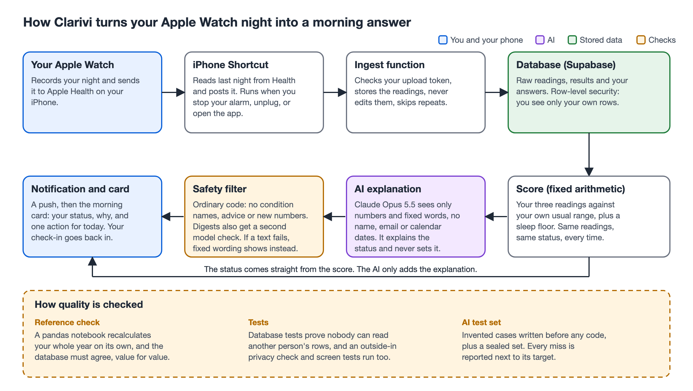

# Clarivi

**A small iPhone app that turns my own Apple Watch data into a plain-words morning answer: what last night means against my normal, why, and one thing to do today.**

> **Portfolio case study.** I built Clarivi to practise managing an AI feature on sensitive data: define quality before building, measure it honestly, and say what missed. It is real software running on my own Apple Watch data. The test so far has one user, me, so it shows whether the pipeline works, not whether the tool changes behaviour. You can [try a demo on made-up data](https://apple-health-rust.vercel.app); it never holds real readings.



## At a glance

- **The user and the problem:** Apple Watch users who train and wear the watch overnight. The Health app shows each number on its own, so I would wake up to a heart rate variability figure and not know whether it was bad for me or a normal wobble.
- **What it does:** each morning a card says Ready, Ease off or Rest, in a few plain sentences, with one action for the day. A "Why today" screen shows exactly how the status was decided.
- **How it works:** an iPhone Shortcut posts the overnight readings. Fixed arithmetic in SQL scores them against my own usual range. The AI (Claude Opus 5.5) writes the wording. It never sets the status.
- **How quality was defined:** ten measures with targets, set on 29 September 2026, before any result existed.
- **Results, week one (19 to 25 October 2026):** the calculations match an independent check on my whole year (261 nights, 0 values differ), and isolation held (checked with two made-up accounts). The sync target was missed: 4 of 7 days had a post against a target of 6, and only 2 of 7 days had a status before noon.
- **Status:** built and in use by one person. Week one is done. Week two, the same test again after a change to the sync, starts on 2 November 2026 at the earliest, once I have checked the changed alarm sync on a real morning. Its results are added when it ends.

## The problem

Apple Watch records the numbers, and the Health app shows each as an isolated daily card. It does not say whether today's reading is unusual for you, or why. People who train regularly need that answer before they decide how hard to go, not a chart to interpret.

Clarivi gives the answer first, in plain words, and keeps the working one tap away. It never names a medical condition and never gives medical advice.

## How it works

One morning, from my side:

1. **Data arrives by itself.** When I stop my alarm, unplug my phone or open a chosen app, an iPhone Shortcut reads my Watch's sleep and heart readings from Health and posts them. There is no manual export.
2. **The server scores the night.** It compares three readings with my own usual range over the last 42 nights: overnight heart rate variability, sleep, and sleeping heart rate. Each reading that is worse than usual earns points, with fixed weights. The points set Ready, Ease off or Rest. A night with sleep far below my usual cannot be Ready (the sleep floor).
3. **The AI writes the explanation.** It is sent only my results, never my name, email address or calendar dates, and it is told the status as a fact. A word filter checks the text, and for the weekly digest a second AI call checks every claim against the data. If anything fails, fixed wording appears instead.
4. **I see the card.** A push notification opens it. I answer "How do you feel today?" before the status shows, so the answer cannot be swayed by it and can be compared with it later. On days with a change, an 8pm question asks whether I followed the nudge.
5. **If the status is missing,** an 11:30 reminder tells me to tap Sync now before noon.

The full picture is in the [architecture diagram](docs/architecture.pdf) and the [tech spec](docs/tech-spec.md).

## Key design choices and tradeoffs

- **Plain words before charts.** The card's briefing uses no numbers; they sit behind "Why today" and "Show the numbers". The cost: less detail on the first screen, and more work on wording.
- **A fixed score, not a learned model.** Weights and thresholds are set in advance, written in SQL, and checked against separate pandas code. I can explain every status. The cost: it cannot adapt to me. A Ready on a very short night showed that, which led to the sleep floor, which in turn made the score less quiet (see the results).
- **The AI explains and never decides.** Its input is an allow-list of results, tested with a marker in every forbidden field. Its output goes through a filter, a retry and a fixed fallback. The cost: a short "Getting ready" wait, about a cent per answer, and a third consent box because Anthropic processes the results. I chose one model and did not compare models.
- **Sync through an iPhone Shortcut, not a native app.** No App Store and no app to maintain. The cost: it depends on iOS, and it is where my main target was missed. The Watch decides when a night reaches Health, and Clarivi cannot see that moment.
- **Private by default.** Every table has row-level security, there are no third-party scripts or tracking, and secrets live only in Supabase's secret store. The cost: more setup, and a consent screen before anything else.
- **Small on purpose.** I cut the test from four people to one before any result existed (D89, D91). I tested three planned analysis modules on my own year before building them, and dropped all three when the data could not support them. The cost: a thinner product, and a result that cannot speak for anyone else.

## How quality was defined and measured

**What good looks like (set 29 September 2026, before any result).**

| Measure | Target |
|---|---|
| Sync | A successful morning sync on at least 6 of 7 days |
| Notifications | Delivered on at least 90% of synced days that have a status |
| Isolation | One person's data never reaches another: no tolerance |
| Correctness | Matches an independent pandas reference; no unfinished night is ever scored |
| Signal, on my year | At least 2 in 3 disrupted days called Ease off or Rest |
| Quiet by default | Ease off and Rest together on no more than about 1 day in 7 |
| Check-ins against status | Agree more often than chance |
| Engagement | Card opened or notification tapped on at least 5 of 7 days |
| Action | Nudge followed about half the time on change days |
| My own account | A short written account at the end |

Before any result, the test shrank from four people over 28 days to one person over one week, so the sync and engagement targets were re-scaled (D89, D91). After week one's results, no target changed. One counting rule did: from week two, a "successful sync" means the status was worked out and shown before noon (D99, decided before any week-two result). Week one stays as recorded.

**How it was measured.** The counting rules were written into a query file before its numbers were computed, and week two reruns the same file. The pandas reference recalculates every night, usual range and status and compares each with the database. The AI was tested on invented cases only: 40 for development, and 20 held-out cases written and graded by separate fresh sessions. The same assistant built the app and counted week one, so the separation is by written rules, not by a second person.

**Results, week one.**

| Measure | Target | Result | Met? |
|---|---|---|---|
| Sync | 6 of 7 days | 4 of 7 days had a post; status before noon on 2 of 7 | No |
| Notifications | 90% | 2 of 2 days with a status (two days only) | Yes |
| Isolation | No tolerance | Passed; every live table has row-level security (shown with two made-up accounts) | Yes |
| Correctness | Match the reference | 261 nights, 1,305 usual ranges and 262 days agree, 0 differ | Yes |
| Signal, my year | 2 in 3 | 2 of 13 disrupted mornings called Ease off or Rest (1 of 13 before the sleep floor) | No |
| Quiet by default | About 1 in 7 | My year: 52 of 231 days (22%), against 29 of 231 (13%) before the sleep floor | No |
| Engagement | 5 of 7 days | 3 of 7 days | No |
| Check-ins | More than chance | 2 of 2 first answers agreed, both on Ready days | Indicative only |
| Action | About half | No Ease off or Rest day, so no question was asked | Not measurable |

Week two: results added after the test ends. The AI explanations passed 38 of 40 invented cases on a single attempt in the live check, and 20 of 20 held-out cases passed the filter (the instruction was tuned on the 40, so that result is partly in-sample). [Details and every caveat](docs/evaluation.md).

**What the results changed.**
- The sync miss, and a log showing that even automatic runs often stopped before the night was complete, led to a third trigger on the alarm, then to dropping its fixed wait and extending the 11:30 reminder (D94, D103).
- A Ready on a short night led to the sleep floor in score version 3 (D96). It made the quiet-by-default target miss on my year, and I report it as a miss.
- Counting the sync three ways showed that "4 of 7" counted any post, which led to the before-noon rule for week two (D99).
- The held-out set found one digest describing a change the data did not show, which led to the second AI check on digests (D95).

**How blind was it?** Not very. One builder, one counter, the rules written first and rerunnable, and nobody else checked the counts.

## Planned and tested like a product

- **Project Memory:** the [product spec](docs/product-spec.md), [design](docs/design.md), [tech spec](docs/tech-spec.md), [phased plan](docs/progress.md) and [MVP decisions](docs/mvp.md), each agreed before building. Also published as a [website](https://claude.ai/artifact/5Aw5x3PYAro7pDXQRkapTe) with live plan ticks.
- **Automated tests:** unit and screen tests (Vitest, Playwright), database tests (pgTAP), server function tests (Deno), and the pandas reference check. Run `python3 checks/run_all.py` for the portfolio checks.
- **One-page case study:** [docs/case-study.pdf](docs/case-study.pdf) (source: [docs/case-study.html](docs/case-study.html)). Week one's results, with week two marked as next.

## Try it

Pick how deep to go:

1. **Open** the [demo on made-up data](https://apple-health-rust.vercel.app): pick a morning (Ready, Ease off, a short night, still learning, waiting, no sync, evening) and tap through the card and "Why today". Nothing in it is real, and the AI texts are fixed examples.
2. **Read** the [one-page case study](docs/case-study.pdf).
3. **Inspect** the [evaluation](docs/evaluation.md): what good looks like, how it was counted, and week one's results with every miss.
4. **Run** the checks on made-up data: [how to run](docs/how-to-run.md).
5. **Browse** the Project Memory website linked above.
6. Coming next: a short video, after week two.

## Where the data goes

The app is served by Vercel, which never sees readings. Readings and results are stored by Supabase in the United States (US East). If a person agrees, Clarivi sends the AI service run by Anthropic only their results, never their name, email or calendar dates. Anthropic does not train on it, and keeps it for up to 30 days. The consent screen says all of this before anything is collected, and Settings can delete or withdraw everything. My full data protection research is in [docs/cayman-data-protection.md](docs/cayman-data-protection.md) and [docs/privacy-impact-assessment.md](docs/privacy-impact-assessment.md).

## Limitations

- **One person, one week so far.** The test can say whether the pipeline works. It cannot say whether the tool changes behaviour.
- **Targets missed in week one:** sync, Signal, quiet by default (on my year) and engagement.
- **Thin Signal evidence.** My year has no illness or major events on the calendar.
- **The Watch decides when the night arrives.** Its sleep sometimes reaches Health hours after I wake, and no fixed wait on the phone can fix that.
- **Blindness.** The same author built the system and counted the results.
- **AI wording.** The AI was tested on invented cases. How it reads on real nights is what I judge by reading it in week two.
- **Not a medical device.** It gives no medical advice and names no condition.

## Repository structure

```
src/        the React and TypeScript app
public/     the web app manifest, icons and the service worker
supabase/   database migrations, server functions and database tests
e2e/        Playwright screen tests
scripts/    the pandas reference check, the AI test set, the Shortcut builder, the Project Memory site builder
checks/     the portfolio checks and the pre-publish scan
docs/       Project Memory, the evaluation, the architecture diagram and the run guide
```

## Skills demonstrated

- **AI product management:** problem framing, a spec and phased plan agreed before building, success targets set up front, and decisions driven by measured results, including the ones that missed.
- **Evaluation:** an independent reference check, an invented test set with a sealed held-out part, and pre-registered counting rules.
- **Responsible AI:** an allow-list for what the AI sees, a filter and a fixed fallback for what it says, and consent for each purpose.
- **Data protection:** row-level security, minimal data, a privacy impact assessment and consent text written for the strictest rules among the places testers might live.
- **Communication:** this README, the decision log, and plain-words copy that went through a wording review.
